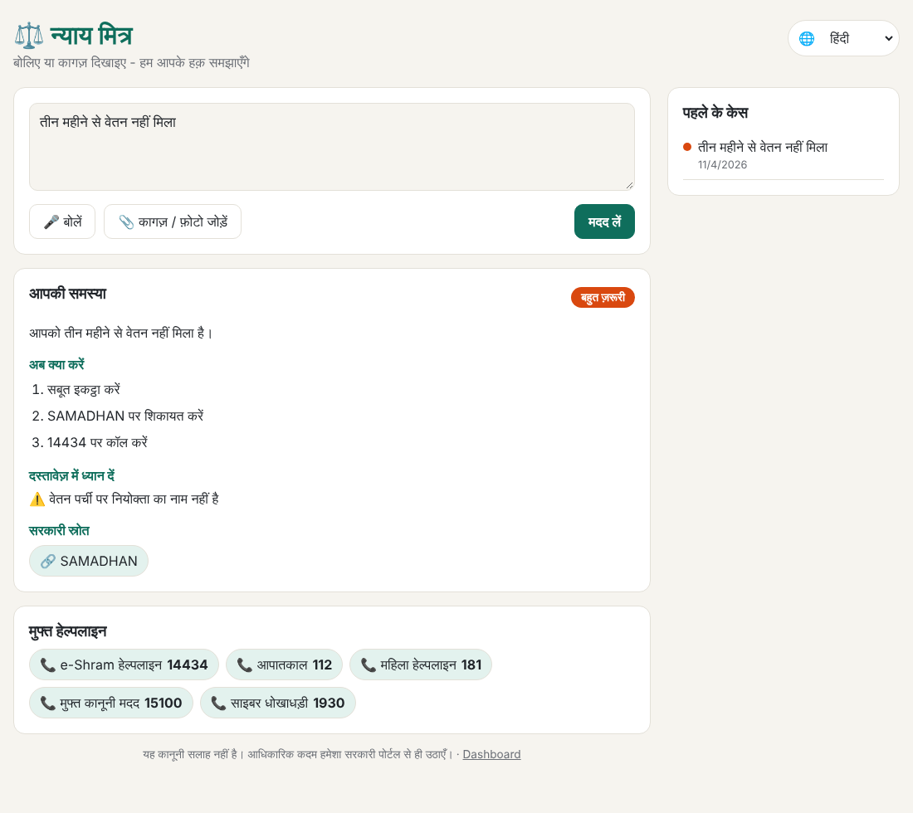
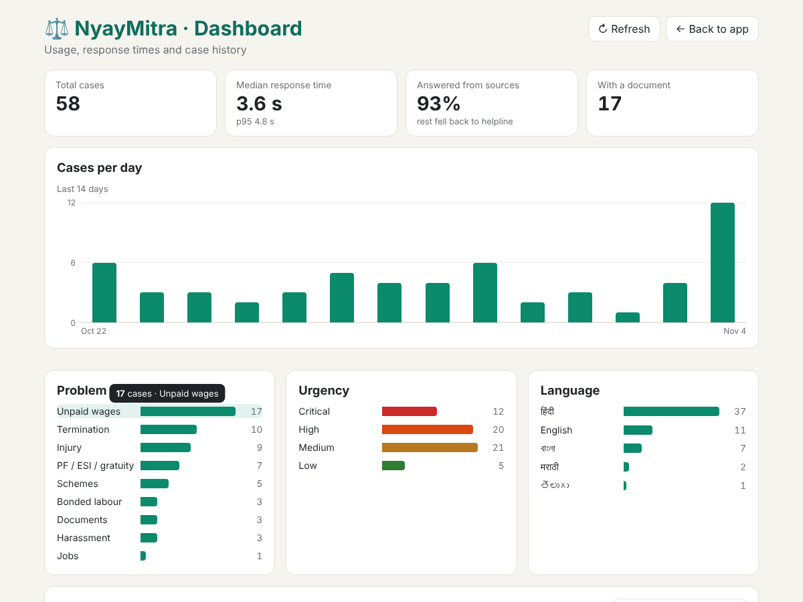
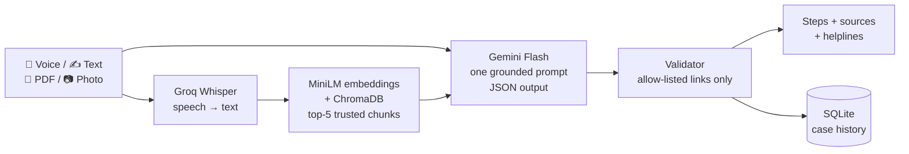

# ⚖️ NyayMitra (न्याय मित्र)

**Voice-first Generative AI assistant that helps migrant and informal workers understand, verify and act on their labour rights - in six Indian languages.**

Migrant workers often can't make sense of contracts, wage slips or official notices because of language barriers and legal jargon, which leaves them open to exploitation. NyayMitra lets a worker **speak** their problem or **show a document**, and replies with short, step-by-step guidance grounded only in verified government sources.


<sub>UI preview (sample response).</sub>

## ✨ What it does

| Pillar | How |
|---|---|
| **Understand** | Speech-to-text (Whisper) in Hindi, English, Bengali, Tamil, Telugu and Marathi (Hinglish works too); reads PDFs and photos of wage slips, letters and notices; explains in plain language. |
| **Verify** | Retrieval-Augmented Generation over a curated knowledge base. The model may only cite allow-listed official links; anything else is stripped. |
| **Connect** | Points the worker to the right channel: SAMADHAN, e-Shram (14434), SHe-Box, myScheme, NCS, emergency 112. |

Other features: urgency rating, document red-flag checks, a 30-topic verified knowledge base, saved case history, an honest "not found" fallback instead of made-up answers, an **admin dashboard**, and a reproducible **evaluation suite**.

### 🌐 Languages

| Language | UI | Voice input | Answers |
|---|---|---|---|
| हिंदी Hindi | ✅ | ✅ | ✅ |
| English | ✅ | ✅ | ✅ |
| বাংলা Bengali | ✅ | ✅ | ✅ |
| தமிழ் Tamil | ✅ | ✅ | ✅ |
| తెలుగు Telugu | ✅ | ✅ | ✅ |
| मराठी Marathi | ✅ | ✅ | ✅ |

The knowledge base is written in English; the multilingual MiniLM model retrieves it from questions in any of these languages, and Gemini answers in the user's language. UI translations live in `frontend/src/i18n.js` - corrections from native speakers are welcome.

### 📊 Admin dashboard

Open **http://localhost:5173/#/admin** (or the "Dashboard" link at the bottom of the app) to see total cases, median / p95 response time, the share of questions answered from sources, cases per day, and breakdowns by problem type, urgency and language, plus a filterable case table with delete. Set `ADMIN_TOKEN` in `.env` to password-protect it.


<sub>Dashboard with sample data.</sub>

## 🏗️ Architecture



## 🧰 Tech stack

- **Frontend:** React 18 + Vite
- **Backend:** Python, FastAPI
- **Speech-to-text:** OpenAI Whisper (`whisper-large-v3-turbo`) via Groq API
- **Embeddings:** `paraphrase-multilingual-MiniLM-L12-v2` (Sentence-Transformers)
- **Vector DB:** ChromaDB
- **LLM:** Google Gemini Flash (multimodal - reads document photos directly)
- **Storage:** SQLite

## 📁 Project structure

```
NyayMitra/
├── backend/
│   ├── app/
│   │   ├── main.py        # FastAPI routes + pipeline
│   │   ├── stt.py         # Groq Whisper transcription
│   │   ├── rag.py         # ChromaDB retrieval
│   │   ├── ingest.py      # builds the vector index
│   │   ├── llm.py         # Gemini call + output validation
│   │   ├── prompts.py     # grounded prompt templates
│   │   ├── documents.py   # PDF / image handling
│   │   ├── db.py          # SQLite case history
│   │   └── config.py
│   ├── knowledge/         # 30 verified knowledge files (Markdown)
│   ├── eval/              # evaluation suite (dataset, metrics, runner)
│   └── tests/
├── frontend/
│   └── src/               # React app (App.jsx, Admin.jsx, api.js, i18n.js)
└── .env.example
```

## 🚀 Getting started

**Prerequisites:** Python 3.11, Node.js 18+, free API keys from [Groq](https://console.groq.com/) and [Google AI Studio](https://aistudio.google.com/apikey).

### 1. Clone and add your keys

```bash
git clone https://github.com/deepankarkumar1310/NyayMitra.git
cd NyayMitra
cp .env.example .env      # Windows: copy .env.example .env
```

Open `.env` and paste your `GROQ_API_KEY` and `GEMINI_API_KEY`.

### 2. Backend

```bash
cd backend
python -m venv .venv
source .venv/bin/activate          # Windows: .venv\Scripts\activate
pip install -r requirements.txt
python -m app.ingest               # builds the vector index (downloads MiniLM once)
uvicorn app.main:app --reload --port 8000
```

### 3. Frontend (new terminal)

```bash
cd frontend
npm install
npm run dev
```

Open **http://localhost:5173**. The dev server proxies `/api` to the backend on port 8000.

> Microphone access needs `localhost` or HTTPS.

## 🔌 API

| Method | Path | Description |
|---|---|---|
| GET | `/api/health` | Status + whether keys are configured |
| POST | `/api/transcribe` | `audio` file (+ `language`) → `{ text }` |
| POST | `/api/ask` | `text`, `language` (`hi`/`en`/`bn`/`ta`/`te`/`mr`), optional `file` (PDF/JPG/PNG/WEBP) → guidance |
| GET | `/api/cases` | Recent cases |
| GET | `/api/cases/{id}` | One saved case |
| GET | `/api/meta` | Supported languages and helplines |
| GET | `/api/admin/stats` | Dashboard statistics (`X-Admin-Token` if `ADMIN_TOKEN` is set) |
| GET | `/api/admin/cases` | All cases for the dashboard |
| DELETE | `/api/admin/cases/{id}` | Delete a case |

Interactive docs: http://localhost:8000/docs

Example:

```bash
curl -F "text=I have not been paid for three months" -F "language=en" http://localhost:8000/api/ask
```

## 🧪 Tests

Gemini, Groq and ChromaDB are mocked, so tests need no API keys or model downloads:

```bash
cd backend
pip install -r requirements-dev.txt
python -m unittest discover -s tests -v
```

GitHub Actions runs the backend tests and the frontend build on every push.

## 📏 Evaluation

`backend/eval/` measures the metrics from the project proposal on a labelled set of **41 questions** (30 topics, 6 languages, plus an off-topic question that should return "not found"):

| Area | Metrics |
|---|---|
| Retrieval | Hit@1, Hit@5, MRR - is the right knowledge file in the top 5? (per language too) |
| Guidance | crisis-type accuracy, answers citing a valid official source, expected source cited, off-topic correctly marked "not found", response time p50 / p95 |
| Speech-to-text | WER and CER (character error rate - better for Indic scripts), transcription time |

```bash
cd backend
python -m app.ingest                     # once
python -m eval.run --retrieval-only      # no API keys needed
python -m eval.run                       # + Gemini (needs GEMINI_API_KEY, ~3-4 min with rate-limit delay)
```

For WER/CER, record a few short voice clips, put them in `backend/eval/audio/`, copy `manifest.example.json` to `manifest.json` with the exact spoken text, and run `python -m eval.run --asr`.

Reports are saved to `backend/eval/results/` as Markdown and JSON - paste the tables into your project report.

## 🧠 Prompt engineering

- **Role + task:** explain the worker's problem in simple Hindi/English
- **Context:** transcript + document text/photo + top-5 retrieved chunks
- **Grounding:** answer only from the retrieved sources
- **Fallback:** if nothing relevant is found, say so and give the helpline / SAMADHAN
- **Format:** strict JSON (summary, urgency, steps, document findings, sources)
- **Allow-list:** official links only - unknown URLs are removed after generation

## 📚 Extending the knowledge base

Add a Markdown file to `backend/knowledge/` with front matter:

```markdown
---
title: Topic name
source: Source name
url: https://official-site.gov.in/
---
Content...
```

Add the URL to `TRUSTED_SOURCES` in `backend/app/config.py`, then re-run `python -m app.ingest`.

## 🗺️ Roadmap

- [ ] Read-aloud answers (text-to-speech) for low-literacy users
- [x] Bengali, Tamil, Telugu, Marathi
- [ ] Odia, Gujarati, Kannada, Bhojpuri
- [ ] WhatsApp bot
- [ ] State-wise minimum wage lookup
- [x] Admin dashboard
- [x] Evaluation suite (retrieval, guidance, WER/CER)
- [ ] Docker + cloud deployment

## ⚠️ Disclaimer

NyayMitra is an academic project and **not legal advice**. Laws and schemes change; always confirm on official government portals or with the Labour Department.

## 👥 Team

Course project for **21CSE306P - Applied Generative AI** (B.Tech, 5th Sem, 2026-27), School of Computing.

- Deepankar Kumar
- M D Faizan Hasan
- Devanshu Kumar
- Mukti Shree Jain

Faculty in-charge: Dr. Vaishnavi Moorthy & Dr. R. Swathy, Department of Networking and Communications.

## 📄 License

[MIT](LICENSE)
